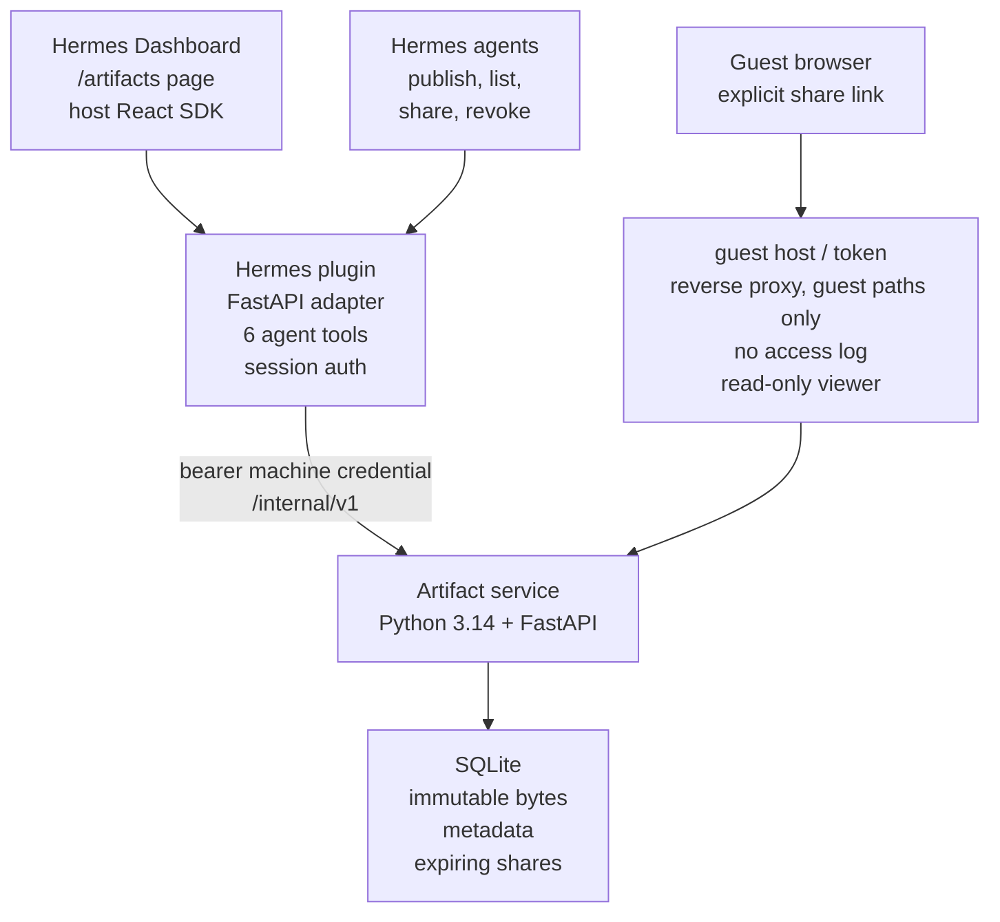

# Hermes Artifacts

The implemented design. The standalone console (`/console/`, optional) serves the same panel as the dashboard tab and calls the service directly with its own login.

The trusted viewer owns toolbar, full-window and fullscreen controls. Generated HTML runs in an opaque-origin sandboxed frame behind a CSP; in the dashboard it sits inside a trusted wrapper frame whose CSP blocks the artifact's own navigations. The public host has no library or management UI.
